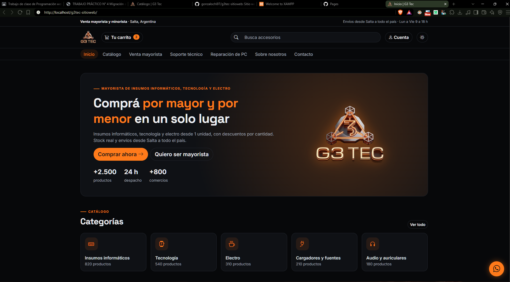
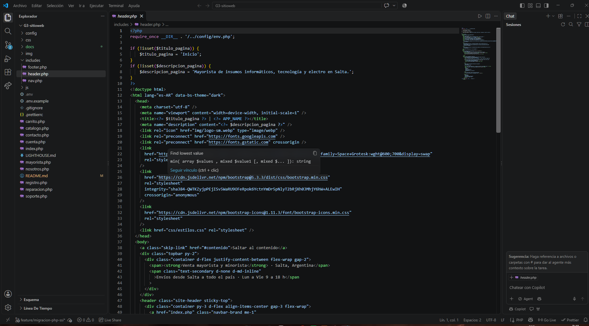
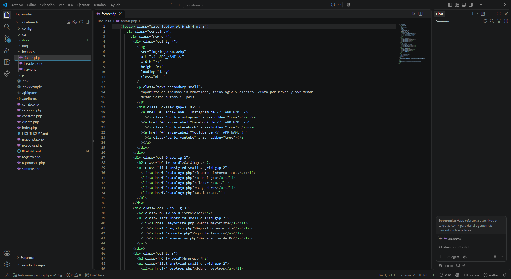
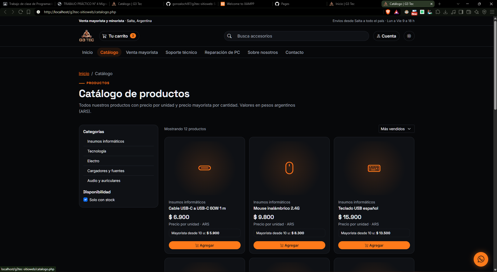
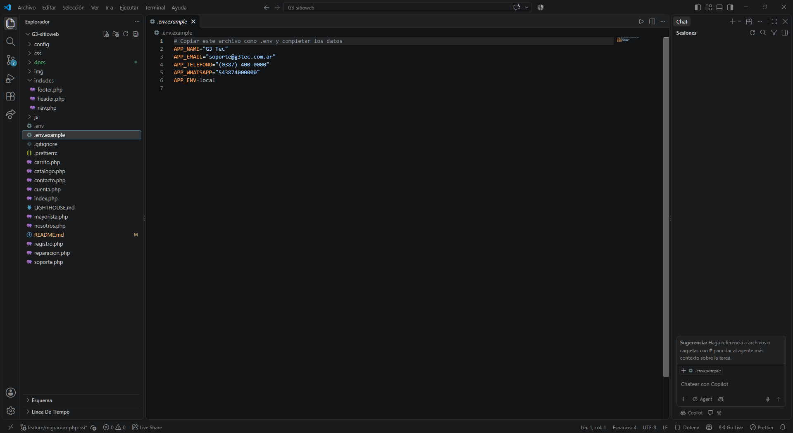
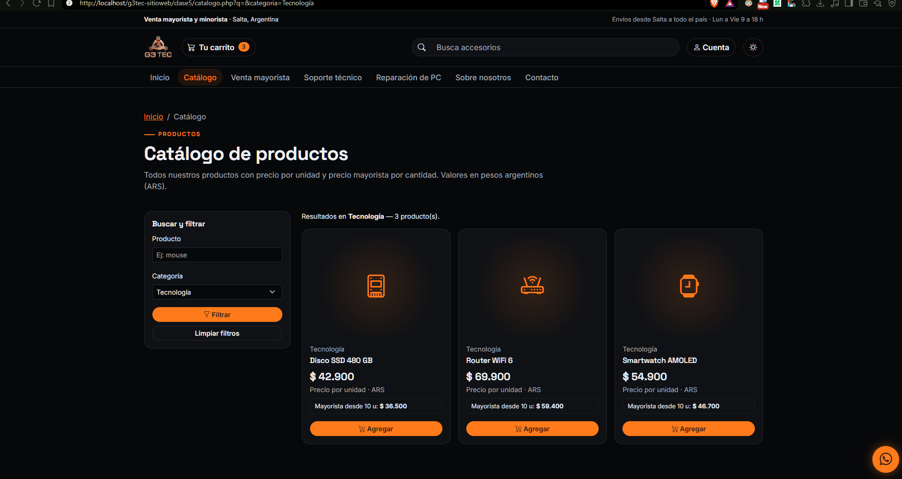
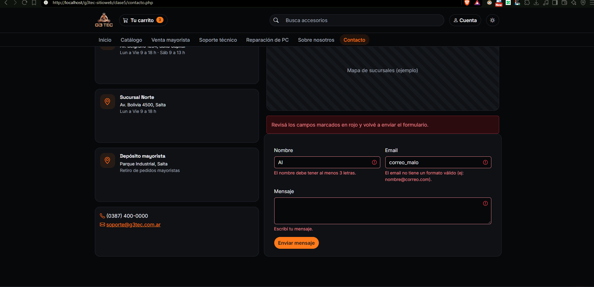

# G3 Tec – Sitio web en PHP

Sitio de **G3 Tec**, un mayorista (ficticio) de insumos informáticos, tecnología y electro de Salta, con venta por mayor y por menor.

El proyecto empezó como una maqueta estática en HTML5 + Bootstrap (TP3). En el **TP4 (Unidad 4)** lo pasé a PHP:

- Las 10 páginas pasaron de `.html` a `.php`.
- El `<head>`, el header, el menú y el footer, que estaban repetidos en todas las páginas, ahora están una sola vez en la carpeta `includes/` y cada página los incluye con `require_once`.
- El título de la pestaña se arma en el servidor con la variable `$titulo_pagina`, y el menú marca con la clase `active` la sección en la que estás.
- Los datos generales (nombre de la empresa, email, teléfono, WhatsApp y entorno) se leen de un archivo `.env` que no se sube al repositorio.

## Evolución del proyecto

| Etapa | Qué tiene | Dónde verlo |
| ----- | --------- | ----------- |
| TP2 | Wireframes y mockups en Figma | [Pagina-web](https://github.com/gonzalochi97/Pagina-web) |
| TP3 | Maqueta estática en HTML5 + Bootstrap | Tag [`v1-html`](https://github.com/gonzalochi97/g3tec-sitioweb/tree/v1-html) y [sitio en GitHub Pages](https://gonzalochi97.github.io/g3tec-sitioweb/) |
| TP4 | Migración a PHP con includes y `.env` | Raíz del repositorio |
| TP5 | Formularios POST y GET con sanitización | Carpeta [`clase5/`](clase5/) |

La versión HTML no se perdió: quedó guardada en el tag `v1-html` y publicada desde la rama `gh-pages`. En el historial de commits se ve primero el cambio de nombre de cada archivo `.html` a `.php` y después el reemplazo del código repetido por los includes.

## Enlaces

- **Diseño en Figma:** https://www.figma.com/design/GMRcCAacl5hp73FwPItskw/Mockup-G3-TEC
- **Wireframes y mockups:** https://github.com/gonzalochi97/Pagina-web
- **Versión estática del TP3 (GitHub Pages):** https://gonzalochi97.github.io/g3tec-sitioweb/

## Tecnologías

- HTML5
- CSS3 (`css/estilos.css`, tema oscuro y claro)
- Bootstrap 5.3 y Bootstrap Icons
- JavaScript (`js/main.js`)
- PHP 8.x
- XAMPP (Apache)
- Git y GitHub

## Estructura

```
g3tec-sitioweb/
├── config/
│   └── env.php          lee el .env y define las constantes
├── includes/
│   ├── header.php       <head>, metadatos, CSS y header
│   ├── nav.php          menú principal con la clase active
│   └── footer.php       pie de página y scripts JS
├── css/
├── js/
├── img/
├── docs/
├── index.php
├── catalogo.php
├── mayorista.php
├── registro.php
├── soporte.php
├── reparacion.php
├── nosotros.php
├── contacto.php
├── carrito.php
├── cuenta.php
├── .env.example         plantilla de variables de entorno
└── .gitignore           excluye el .env
```

Así queda una página después de la migración:

```php
<?php
$titulo_pagina = "Catálogo";
$descripcion_pagina = "Catálogo de insumos informáticos, tecnología, electro, cargadores y audio con precios mayoristas.";
require_once 'includes/header.php';
?>
    <main id="contenido" class="container py-4 py-lg-5">
      ...
    </main>
<?php require_once 'includes/footer.php'; ?>
```

## Instalación y ejecución local (XAMPP)

1. Instalar [XAMPP](https://www.apachefriends.org/es/index.html) e iniciar **Apache** desde el panel de control.
2. Clonar el repositorio dentro de `htdocs`:
   ```bash
   cd C:/xampp/htdocs
   git clone https://github.com/gonzalochi97/g3tec-sitioweb.git
   cd g3tec-sitioweb
   ```
3. Crear el `.env` a partir de la plantilla y completar los datos:
   ```bash
   cp .env.example .env
   ```
4. Abrir en el navegador: http://localhost/g3tec-sitioweb/

Si falta el `.env`, la página muestra un aviso que pide crearlo.

## Variables de entorno

| Variable       | Uso                                           |
| -------------- | --------------------------------------------- |
| `APP_NAME`     | Nombre de la empresa (título, logo, footer)   |
| `APP_EMAIL`    | Email de soporte (footer y contacto)          |
| `APP_TELEFONO` | Teléfono (footer y contacto)                  |
| `APP_WHATSAPP` | Número del botón flotante de WhatsApp         |
| `APP_ENV`      | Entorno de ejecución (`local` o `produccion`) |

Con `APP_ENV=local`, el footer muestra la etiqueta "Entorno local".

## Capturas

### Servidor local funcionando



### Estructura modular (SSI)





### Título dinámico y menú activo




### Archivo .env.example



## Clase 5 – Formularios y seguridad web

Todo el desarrollo de esta entrega está en la carpeta [`clase5/`](clase5/). Es una copia del sitio del TP4 a la que le agregué el procesamiento de formularios en PHP. Se abre en http://localhost/g3tec-sitioweb/clase5/ y usa el mismo `.env` de la raíz.

### Formulario por POST: Contacto (`clase5/contacto.php`)

- Campos: nombre, email y mensaje. El formulario se envía a la misma página con `method="post"`.
- Cada dato pasa por la función `limpiar()` (`clase5/includes/funciones.php`), que aplica `trim()`, `stripslashes()` y `htmlspecialchars()` antes de usarlo o mostrarlo.
- Validación en el servidor:
  - Ningún campo puede llegar vacío (`empty()`, `isset()`).
  - El nombre debe tener al menos 3 letras y el mensaje al menos 10 caracteres.
  - El email se valida con `filter_var($email, FILTER_VALIDATE_EMAIL)`.
- Si hay errores, se muestra un aviso general, cada campo con error queda en rojo con su mensaje y **los datos escritos se conservan**.
- Si todo está bien, se muestra un mensaje de éxito con el nombre de la persona y el formulario queda vacío.

### Formulario por GET: Búsqueda y filtro del catálogo (`clase5/catalogo.php`)

- Los productos están en un array de PHP y se muestran con `foreach`.
- El buscador del header y el formulario lateral envían `q` (texto) y `categoria` por GET, por ejemplo `catalogo.php?q=mouse&categoria=Insumos+informáticos`.
- `q` y `categoria` se limpian con `limpiar()`. La categoría solo se acepta si está en la lista de categorías (`in_array()`). Si no existe, se avisa y se muestran todos los productos.
- Se informa cuántos productos se encontraron, o se avisa que no hubo resultados. El texto buscado queda escrito en los campos.

### Prueba de XSS

Si en el buscador se escribe `<script>alert('hola')</script>`, el texto aparece en pantalla tal cual y no se ejecuta, porque `htmlspecialchars()` convierte `<` y `>` en `&lt;` y `&gt;`.

### Capturas

**GET: búsqueda por texto**


**GET: filtro por categoría**



**XSS: el script se muestra como texto**


**POST: errores de validación con los datos conservados**



**POST: envío exitoso**


## Flujo de trabajo con Git

- Rama `feature/migracion-php-ssi`, creada desde `main`.
- Tag `v1-html` sobre `main` antes de empezar, para marcar la versión del TP3.
- Commits separados para la configuración, las plantillas, el renombrado de `.html` a `.php`, el uso de los includes y la documentación.
- Pull Request de `feature/migracion-php-ssi` a `main`.

La auditoría de Lighthouse del TP3 está en [LIGHTHOUSE.md](LIGHTHOUSE.md).

> El contenido, los precios y los datos de contacto son de ejemplo. Los formularios no envían datos reales.
