# G3 Tec – Sitio web en PHP

Sitio de **G3 Tec**, un mayorista (ficticio) de insumos informáticos, tecnología y electro de Salta, con venta por mayor y por menor.

El proyecto empezó como una maqueta estática en HTML5 + Bootstrap (TP3). En el **TP4 (Unidad 4)** lo pasé a PHP:

- Las 10 páginas pasaron de `.html` a `.php`.
- El `<head>`, el header, el menú y el footer, que estaban repetidos en todas las páginas, ahora están una sola vez en la carpeta `includes/` y cada página los incluye con `require_once`.
- El título de la pestaña se arma en el servidor con la variable `$titulo_pagina`, y el menú marca con la clase `active` la sección en la que estás.
- Los datos generales (nombre de la empresa, email, teléfono, WhatsApp y entorno) se leen de un archivo `.env` que no se sube al repositorio.

Después fui sumando lo de cada unidad: formularios con sanitización (TP5), base de datos en MySQL (TP6), un CRUD con PDO (TP7), login con sesiones (TP8), un buscador con Fetch API y JSON (TP9) y, por último, la separación en MVC y una prueba con CodeIgniter 4 (TP10).

## Evolución del proyecto

| Etapa | Qué tiene | Dónde verlo |
| ----- | --------- | ----------- |
| TP1 | Tema del sitio, sitios de referencia, wireframes a mano y mapa del sitio | [Pagina-web](https://github.com/gonzalochi97/Pagina-web) (carpetas `TPS` y `Bocetos.Wideframe`) |
| TP2 | Mockups en Figma (tema oscuro y claro) | [Pagina-web](https://github.com/gonzalochi97/Pagina-web) |
| TP3 | Maqueta estática en HTML5 + Bootstrap | Tag [`v1-html`](https://github.com/gonzalochi97/g3tec-sitioweb/tree/v1-html) y [sitio en GitHub Pages](https://gonzalochi97.github.io/g3tec-sitioweb/) |
| TP4 | Migración a PHP con includes y `.env` | Raíz del repositorio |
| TP5 | Formularios POST y GET con sanitización | Carpeta [`clase5/`](clase5/) |
| TP6 | Modelo de base de datos normalizado y consultas SQL | Carpeta [`tp6/`](tp6/) |
| TP7 | CRUD de productos con PDO y consultas preparadas | Carpetas [`admin/`](admin/) y [`config/conexion.php`](config/conexion.php) |
| TP8 | Registro, login y sesiones con `password_hash()` | Carpeta [`auth/`](auth/) |
| TP9 | Buscador en vivo con Fetch API y respuesta JSON | [`api/`](api/), [`js/buscador.js`](js/buscador.js) y [`admin/busqueda.php`](admin/busqueda.php) |
| TP10 | Refactorización a MVC y módulo en CodeIgniter 4 | [`app/`](app/), [`mvc_productos.php`](mvc_productos.php) y [`tp10-framework/`](tp10-framework/) |

La versión HTML no se perdió: quedó guardada en el tag `v1-html` y publicada desde la rama `gh-pages`. En el historial de commits se ve primero el cambio de nombre de cada archivo `.html` a `.php` y después el reemplazo del código repetido por los includes.

## TP1 – Diseño preliminar

El primer trabajo fue elegir el tema del sitio y planificarlo antes de diseñarlo. Está en el repositorio [Pagina-web](https://github.com/gonzalochi97/Pagina-web):

- **Tema:** como me dedico al soporte y mantenimiento de equipos, elegí una tienda de electrónica e insumos con venta por menor y por mayor.
- **Sitios de referencia:** analicé Mercado Libre, Maximus Gaming, Temu, Comodín Online y Black Salta, con tres aspectos positivos y tres negativos de cada uno. De ahí salieron ideas que después usé, como el tema oscuro y claro y la compra mayorista.
- **Wireframes a mano**, **mapa del sitio** y un **wireframe en Figma** en blanco y negro (carpeta [`Bocetos.Wideframe`](https://github.com/gonzalochi97/Pagina-web/tree/main/Bocetos.Wideframe)).
- El documento del TP está en [`TPS/`](https://github.com/gonzalochi97/Pagina-web/tree/main/TPS).

| Wireframes a mano | Mapa del sitio | Wireframe en Figma |
| --- | --- | --- |
|  |  |  |

## TP2 – Mockups en Figma

Con los wireframes del TP1 armé el diseño en Figma: 19 pantallas en escritorio (1440 px), con estilo minimalista, detalles en naranja y cian, y tema oscuro y claro. Todas las pantallas están en el repositorio [Pagina-web](https://github.com/gonzalochi97/Pagina-web) y el diseño se puede abrir en [Figma](https://www.figma.com/design/GMRcCAacl5hp73FwPItskw/Mockup-G3-TEC).

| Inicio (oscuro) | Inicio (claro) |
| --- | --- |
|  |  |

| Catálogo (oscuro) | Venta mayorista (claro) |
| --- | --- |
|  |  |

## TP3 – Maqueta en HTML5 y Bootstrap

Pasé el diseño a 10 páginas en HTML5 con Bootstrap 5.3, un CSS propio para los colores y el tema oscuro y claro, y un poco de JavaScript para el cambio de tema (que queda guardado en `localStorage`). El código lo formateé con Prettier y lo revisé con Lighthouse ([LIGHTHOUSE.md](LIGHTHOUSE.md)).

Esta versión quedó guardada en el tag [`v1-html`](https://github.com/gonzalochi97/g3tec-sitioweb/tree/v1-html) y se puede ver en [GitHub Pages](https://gonzalochi97.github.io/g3tec-sitioweb/).

| Tema oscuro | Tema claro |
| --- | --- |
| 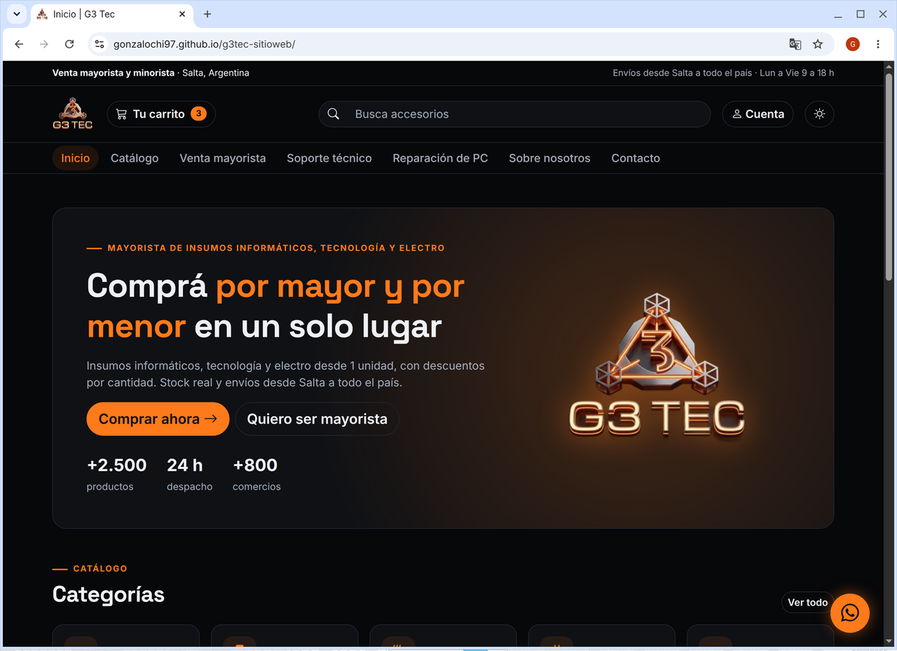 | 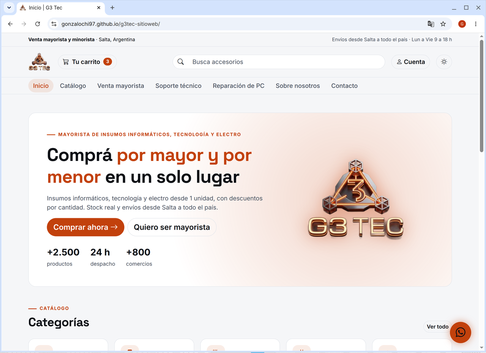 |

## Enlaces

- **Diseño en Figma:** https://www.figma.com/design/GMRcCAacl5hp73FwPItskw/Mockup-G3-TEC
- **Wireframes y mockups:** https://github.com/gonzalochi97/Pagina-web
- **Versión estática del TP3 (GitHub Pages):** https://gonzalochi97.github.io/g3tec-sitioweb/
- **Pagina G3 Live:** https://sheep-slacked-postnasal.ngrok-free.dev/g3tec-sitioweb/index.php o https://g3tec.infy.click/
## Tecnologías

- HTML5
- CSS3 (`css/estilos.css`, tema oscuro y claro)
- Bootstrap 5.3 y Bootstrap Icons
- JavaScript (`js/main.js`)
- PHP 8.x
- MySQL (phpMyAdmin) y PDO
- Fetch API y JSON
- CodeIgniter 4 y Composer
- XAMPP (Apache)
- Git y GitHub

## Estructura

```
g3tec-sitioweb/
├── admin/               CRUD de productos (TP7) y buscador AJAX (TP9)
├── api/
│   └── buscar_productos.php   devuelve los productos en JSON (TP9)
├── app/                 Modelo, Vista y Controlador de productos (TP10)
├── auth/                registro, login, logout y auth_guard (TP8)
├── clase5/              formularios POST y GET (TP5)
├── tp6/                 schema.sql, consultas.sql y NORMALIZACION.md (TP6)
├── sql/                 tablas y datos de la tienda (ver Instalación)
├── tp10-framework/      proyecto en CodeIgniter 4 (TP10)
├── mvc_productos.php    punto de entrada de la versión MVC (TP10)
├── config/
│   ├── env.php          lee el .env y define las constantes
│   └── conexion.php     conexión a MySQL con PDO (TP7)
├── includes/
│   ├── header.php       <head>, metadatos, CSS y header
│   ├── nav.php          menú principal con la clase active
│   └── footer.php       pie de página y scripts JS
├── css/
├── js/
├── img/
├── docs/
├── index.php
├── catalogo.php
├── mayorista.php
├── registro.php
├── soporte.php
├── reparacion.php
├── nosotros.php
├── contacto.php
├── carrito.php
├── cuenta.php
├── compra.php, listado_mayorista.php, seguimiento.php
├── consulta_reparacion.php, presupuesto.php, terminos.php
├── .env.example         plantilla de variables de entorno
└── .gitignore           excluye el .env
```

Así queda una página después de la migración:

```php
<?php
$titulo_pagina = "Catálogo";
$descripcion_pagina = "Catálogo de insumos informáticos, tecnología, electro, cargadores y audio con precios mayoristas.";
require_once 'includes/header.php';
?>
    <main id="contenido" class="container py-4 py-lg-5">
      ...
    </main>
<?php require_once 'includes/footer.php'; ?>
```

## Instalación y ejecución local (XAMPP)

1. Instalar [XAMPP](https://www.apachefriends.org/es/index.html) e iniciar **Apache** desde el panel de control.
2. Clonar el repositorio dentro de `htdocs`:
   ```bash
   cd C:/xampp/htdocs
   git clone https://github.com/gonzalochi97/g3tec-sitioweb.git
   cd g3tec-sitioweb
   ```
3. Crear el `.env` a partir de la plantilla y completar los datos:
   ```bash
   cp .env.example .env
   ```
4. Abrir en el navegador: http://localhost/g3tec-sitioweb/

Si falta el `.env`, la página muestra un aviso que pide crearlo.

Para las partes que usan base de datos (TP6 a TP10):

5. Iniciar también **MySQL** desde el panel de XAMPP.
6. En http://localhost/phpmyadmin, ir a **Importar** y cargar primero `tp6/schema.sql` (crea la base `mi_proyecto_web` con sus tablas) y después `tp6/consultas.sql` (carga datos de ejemplo).
7. Revisar usuario y contraseña de MySQL en `config/conexion.php` (en XAMPP por defecto es `root` sin contraseña).
8. Crear un usuario en http://localhost/g3tec-sitioweb/auth/registro.php y entrar desde http://localhost/g3tec-sitioweb/auth/login.php.

Para la tienda completa, después de `tp6/` hay que ejecutar los archivos de la carpeta `sql/` en este orden (desde phpMyAdmin o con `mysql -u root < archivo.sql`):

| Archivo | Qué agrega |
|---|---|
| `mayoristas.sql` | rol Mayorista y solicitudes de cuenta mayorista |
| `categorias.sql` | categorías del sitio |
| `compra.sql` | precio mayorista, precio de oferta y productos |
| `carga_productos_faltantes.sql` | productos que faltan si la base ya tenía otras categorías |
| `consultas.sql` | consultas de reparación y presupuestos |
| `pedidos_especiales.sql` | tipo y estado de los pedidos |
| `seguimiento.sql` | estados de seguimiento de pedidos y reparaciones, y turnos |
| `mensajes.sql` | mensajes del formulario de contacto |
| `imagenes.sql` | imagen de cada producto |

## Funciones de la tienda

- **Catálogo** leído de la base, con búsqueda, categorías, ofertas y orden por precio.
- **Carrito y compra minorista:** guarda el pedido y su detalle y descuenta el stock.
- **Mayoristas:** precio especial desde 10 unidades. El pedido queda pendiente hasta que el administrador lo aprueba y no descuenta stock.
- **Seguimiento de pedidos:** el administrador cambia el estado en Panel > Pedidos y el cliente ve una barra de avance en Mi cuenta.
- **Soporte técnico:** consultas de reparación, presupuestos y turnos. Cada orden tiene un número (G3-0001) para seguir su estado en `seguimiento.php` con el email o teléfono.
- **Imágenes de productos:** se suben desde el panel (JPG, PNG o WEBP de hasta 2 MB) y se guardan en `img/productos/`. Si un producto no tiene, se muestra el ícono de su categoría.
- **Mensajes:** lo que se escribe en Contacto llega a Panel > Mensajes. Si el cliente tiene cuenta, ve la respuesta en Mi cuenta.
- **Seguridad:** consultas preparadas con PDO, `htmlspecialchars` en la salida, contraseñas con `password_hash`, token CSRF en todos los formularios POST y control de rol en el panel.

## Variables de entorno

| Variable       | Uso                                           |
| -------------- | --------------------------------------------- |
| `APP_NAME`     | Nombre de la empresa (título, logo, footer)   |
| `APP_EMAIL`    | Email de soporte (footer y contacto)          |
| `APP_TELEFONO` | Teléfono (footer y contacto)                  |
| `APP_WHATSAPP` | Número del botón flotante de WhatsApp         |
| `APP_ENV`      | Entorno de ejecución (`local` o `produccion`) |

Con `APP_ENV=local`, el footer muestra la etiqueta "Entorno local".

## TP4 – Capturas de la migración a PHP

### Servidor local funcionando


### Estructura modular (SSI)


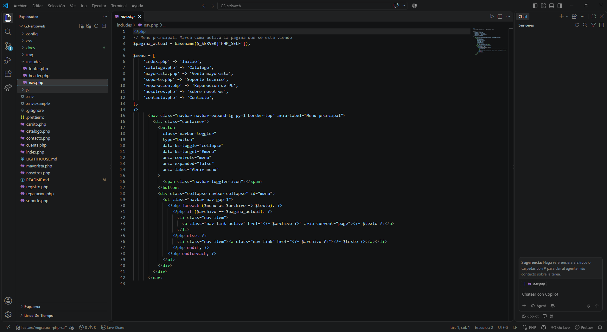


### Título dinámico y menú activo


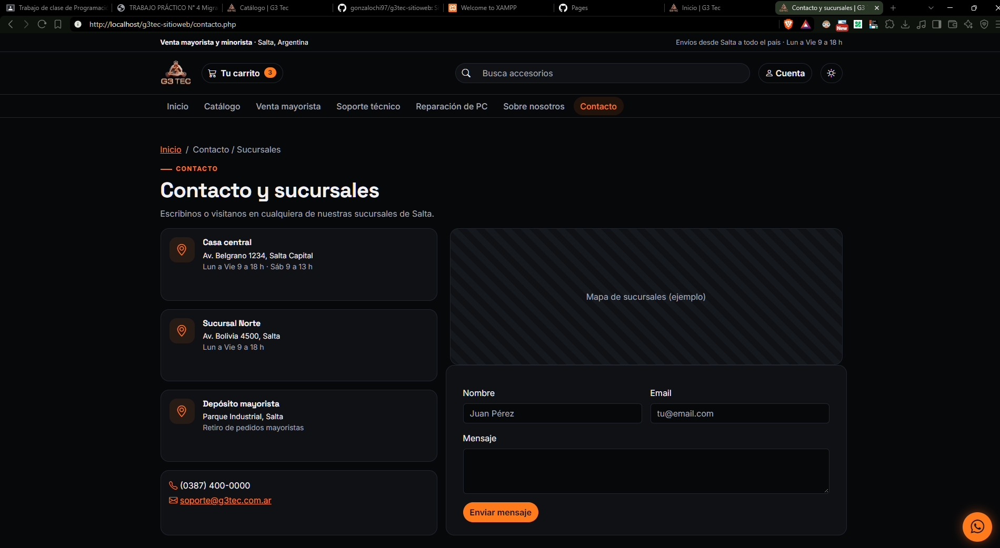

### Archivo .env.example


## TP5 – Formularios y seguridad web (`clase5/`)

Todo el desarrollo de esta entrega está en la carpeta [`clase5/`](clase5/). Es una copia del sitio del TP4 a la que le agregué el procesamiento de formularios en PHP. Se abre en http://localhost/g3tec-sitioweb/clase5/ y usa el mismo `.env` de la raíz.

### Formulario por POST: Contacto (`clase5/contacto.php`)

- Campos: nombre, email y mensaje. El formulario se envía a la misma página con `method="post"`.
- Cada dato pasa por la función `limpiar()` (`clase5/includes/funciones.php`), que aplica `trim()`, `stripslashes()` y `htmlspecialchars()` antes de usarlo o mostrarlo.
- Validación en el servidor:
  - Ningún campo puede llegar vacío (`empty()`, `isset()`).
  - El nombre debe tener al menos 3 letras y el mensaje al menos 10 caracteres.
  - El email se valida con `filter_var($email, FILTER_VALIDATE_EMAIL)`.
- Si hay errores, se muestra un aviso general, cada campo con error queda en rojo con su mensaje y **los datos escritos se conservan**.
- Si todo está bien, se muestra un mensaje de éxito con el nombre de la persona y el formulario queda vacío.

### Formulario por GET: Búsqueda y filtro del catálogo (`clase5/catalogo.php`)

- Los productos están en un array de PHP y se muestran con `foreach`.
- El buscador del header y el formulario lateral envían `q` (texto) y `categoria` por GET, por ejemplo `catalogo.php?q=mouse&categoria=Insumos+informáticos`.
- `q` y `categoria` se limpian con `limpiar()`. La categoría solo se acepta si está en la lista de categorías (`in_array()`). Si no existe, se avisa y se muestran todos los productos.
- Se informa cuántos productos se encontraron, o se avisa que no hubo resultados. El texto buscado queda escrito en los campos.

### Prueba de XSS

Si en el buscador se escribe `<script>alert('hola')</script>`, el texto aparece en pantalla tal cual y no se ejecuta, porque `htmlspecialchars()` convierte `<` y `>` en `&lt;` y `&gt;`.

### Capturas

**GET: búsqueda por texto**

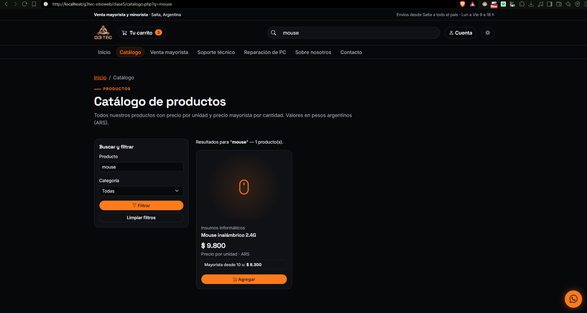

**GET: filtro por categoría**


**XSS: el script se muestra como texto**

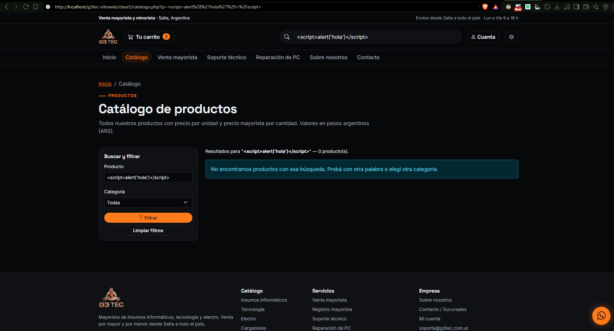

**POST: errores de validación con los datos conservados**


**POST: envío exitoso**

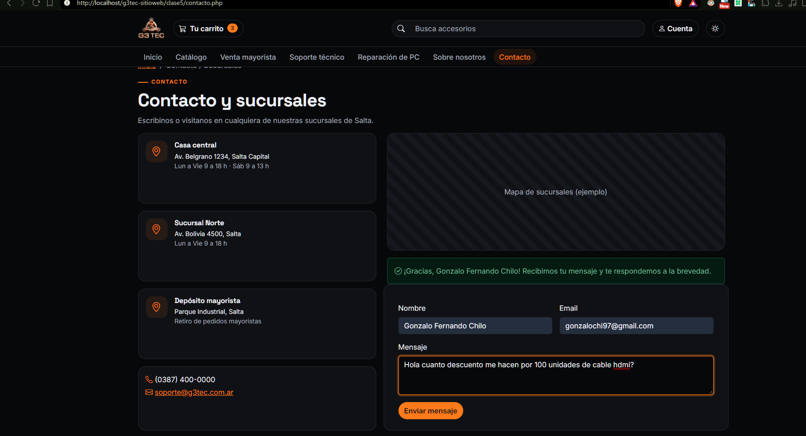

## TP6 – Base de datos

El diseño de la base está en la carpeta [`tp6/`](tp6/):

- [`NORMALIZACION.md`](tp6/NORMALIZACION.md): parto de una tabla de pedidos sin normalizar (con varios productos en una misma celda) y la llevo paso a paso a 1FN, 2FN y 3FN.
- [`schema.sql`](tp6/schema.sql): crea la base `mi_proyecto_web` con las tablas `roles`, `usuarios`, `categorias`, `productos`, `pedidos` y `detalle_pedidos`, sus claves foráneas e índices por email y por categoría.
- [`consultas.sql`](tp6/consultas.sql): ejemplos de `INSERT`, `SELECT` (con `JOIN`), `UPDATE` y `DELETE`.

| Base en phpMyAdmin | Relaciones entre tablas |
| --- | --- |
| 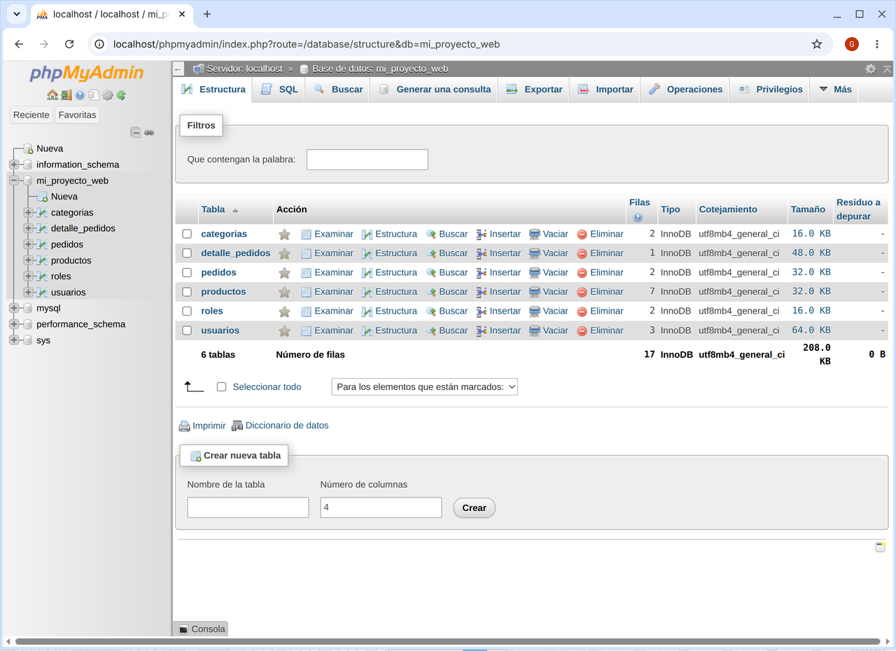 | 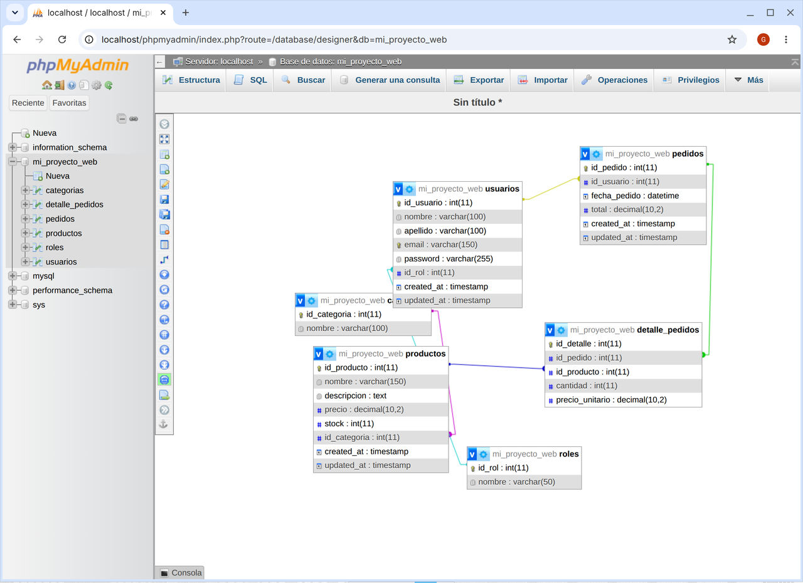 |

## TP7 – CRUD con PDO

- [`config/conexion.php`](config/conexion.php) crea la conexión con `PDO`, con errores en modo excepción y `FETCH_ASSOC`.
- [`admin/index.php`](admin/index.php) lista los productos en una tabla (**Read**).
- [`admin/crear.php`](admin/crear.php) agrega un producto (**Create**).
- [`admin/editar.php`](admin/editar.php) modifica un producto (**Update**).
- [`admin/eliminar.php`](admin/eliminar.php) borra un producto por su id (**Delete**).

Todas las consultas que reciben datos usan `prepare()` y `execute()` con parámetros (`:nombre`, `:id`, etc.), así los valores nunca se pegan directamente en el SQL y se evita la inyección SQL. Lo que se muestra en pantalla pasa por `htmlspecialchars()`.

| Listado (Read) | Alta (Create) | Edición (Update) |
| --- | --- | --- |
| 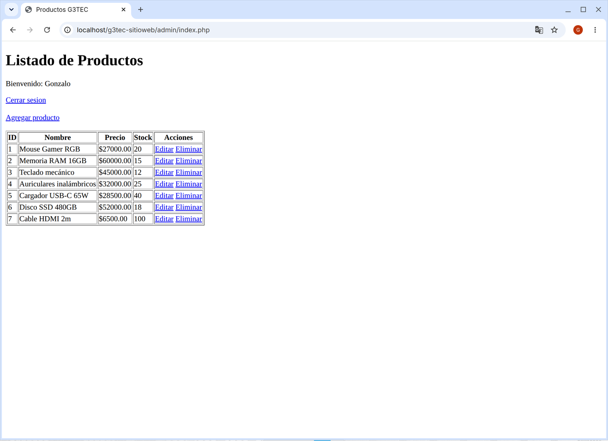 |  | 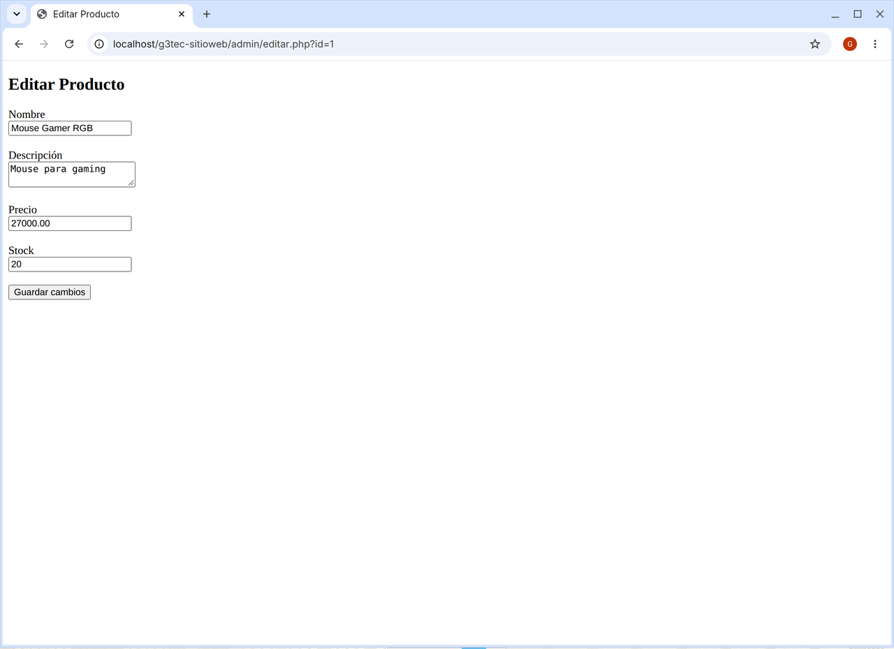 |

## TP8 – Sesiones y autenticación

- [`auth/registro.php`](auth/registro.php): revisa que el email no esté registrado y guarda la contraseña con `password_hash()` (nunca en texto plano).
- [`auth/login.php`](auth/login.php): busca el usuario por email, compara con `password_verify()` y, si es correcto, guarda `usuario_id`, `usuario_nombre` y `rol` en `$_SESSION`. Usa `session_regenerate_id(true)` para cambiar el id de sesión al ingresar.
- [`auth/auth_guard.php`](auth/auth_guard.php): se incluye al principio de las páginas privadas; si no hay sesión, redirige al login.
- [`auth/logout.php`](auth/logout.php): vacía `$_SESSION` y llama a `session_destroy()`.

El panel `admin/index.php` está protegido con el guard y muestra el nombre del usuario que inició sesión.

| Registro | Login | Acceso sin sesión |
| --- | --- | --- |
| 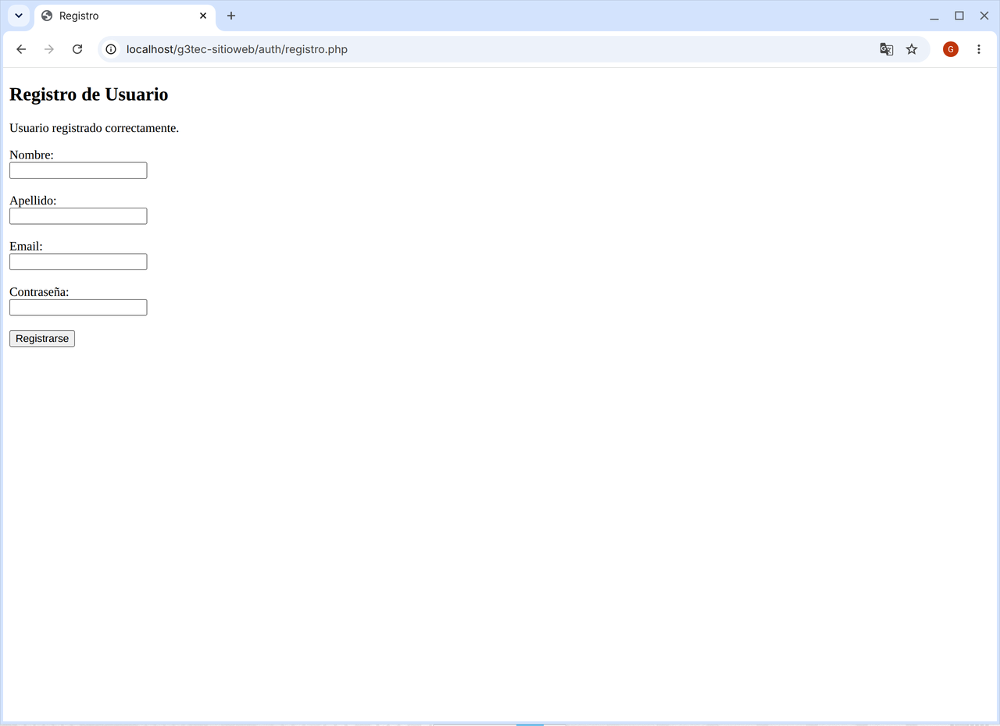 | 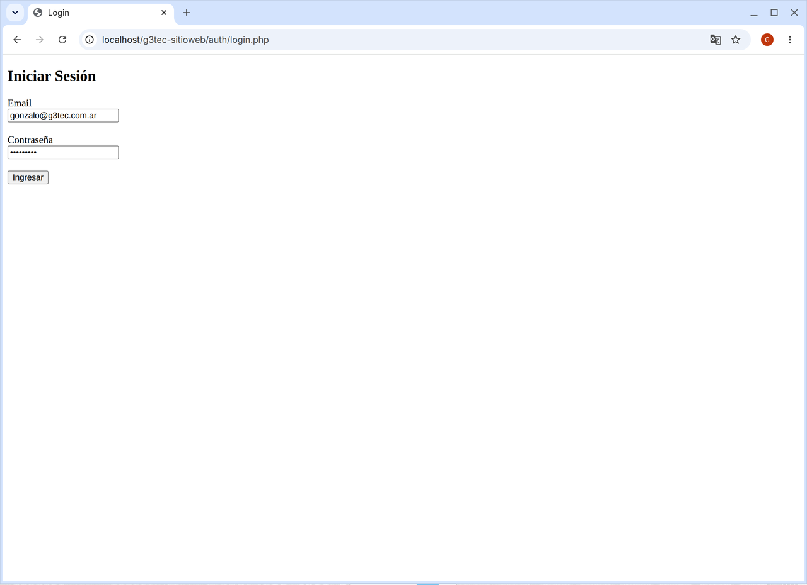 | 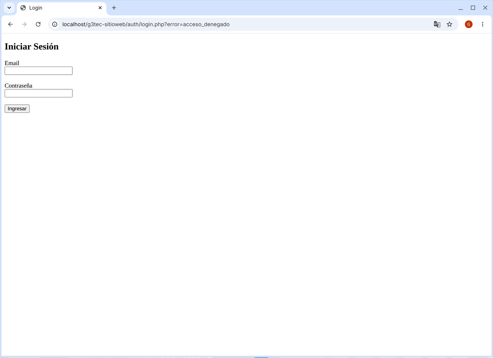 |

Al entrar a `admin/` sin haber iniciado sesión, el guard redirige al login con `?error=acceso_denegado`.

## TP9 – Fetch API y JSON

- [`api/buscar_productos.php`](api/buscar_productos.php) recibe `q` por GET, busca con `LIKE` en una consulta preparada y responde en JSON (`{"status": "success", "data": [...]}`), con código 200 o 500 si falla la base.
- [`js/buscador.js`](js/buscador.js) escucha el evento `input` del buscador, llama a la API con `fetch()` y `async/await` y arma los resultados sin recargar la página.
- [`admin/busqueda.php`](admin/busqueda.php) es la página con el buscador.

Se prueba en http://localhost/g3tec-sitioweb/admin/busqueda.php y la respuesta de la API se puede ver directamente en http://localhost/g3tec-sitioweb/api/buscar_productos.php?q=mouse.

| Buscador en vivo | Respuesta de la API |
| --- | --- |
| 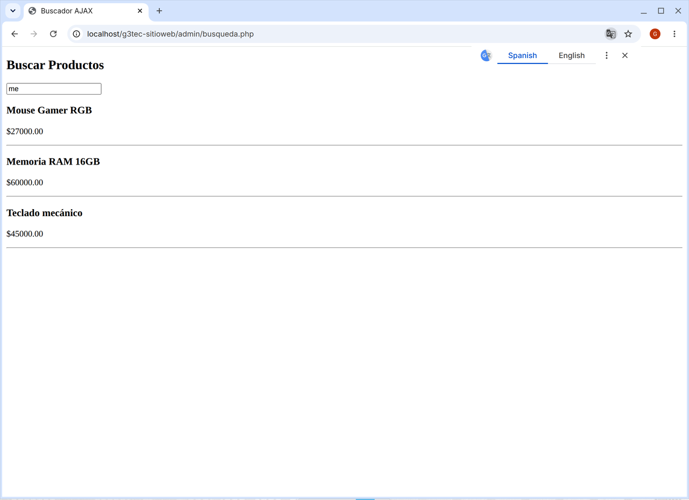 | 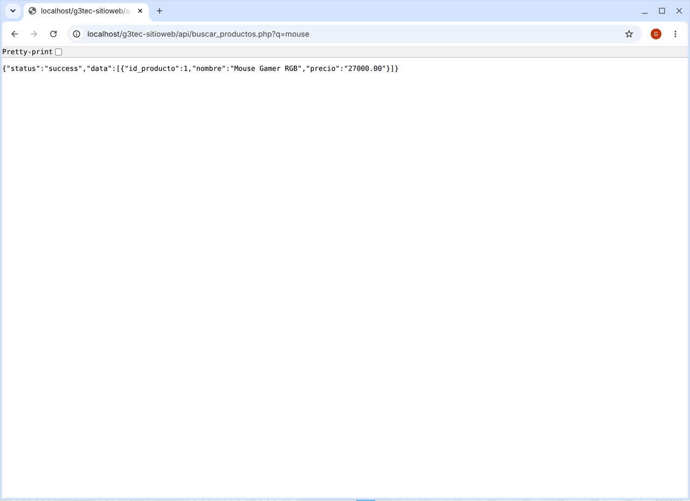 |

## TP10 – MVC y framework

**Refactorización a MVC (PHP puro)**

- **Modelo:** [`app/Models/Producto.php`](app/Models/Producto.php), con el método `obtenerTodos()` que hace la consulta.
- **Controlador:** [`app/Controllers/ProductoController.php`](app/Controllers/ProductoController.php), que recibe la conexión y le pide los datos al modelo.
- **Vista:** [`app/Views/productos.php`](app/Views/productos.php), que solo muestra la tabla.
- [`mvc_productos.php`](mvc_productos.php) junta las tres partes. Se abre en http://localhost/g3tec-sitioweb/mvc_productos.php.

**CodeIgniter 4**

En [`tp10-framework/`](tp10-framework/) está un proyecto de CodeIgniter 4 con el controlador `Productos`, su vista y la ruta `productos` definida en `app/Config/Routes.php`. Para probarlo:

```bash
cd tp10-framework
composer install
php spark serve
```

y abrir http://localhost:8080/productos.

| Versión MVC | CodeIgniter 4 |
| --- | --- |
| 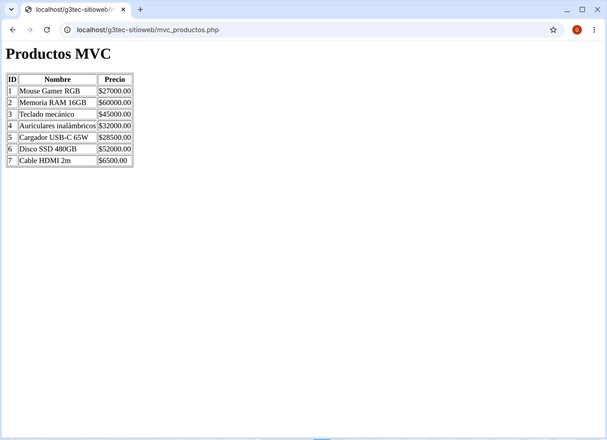 | 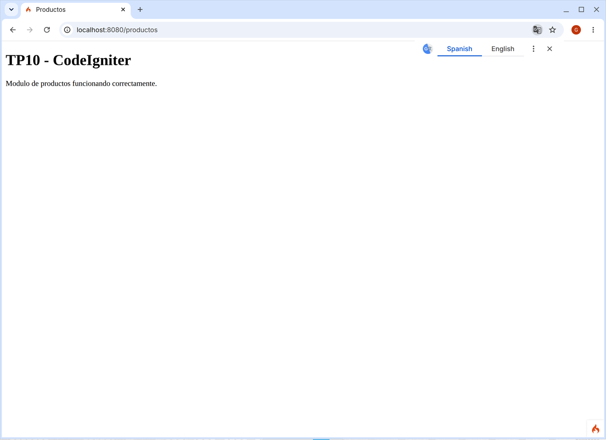 |

## Flujo de trabajo con Git

- Tag `v1-html` sobre `main`, para marcar la versión del TP3, que sigue publicada desde la rama `gh-pages`.
- TP3: rama `feature/maquetacion` y Pull Request #1.
- TP4: rama `feature/migracion-php-ssi` y Pull Request #2, con commits separados para la configuración, las plantillas, el renombrado de `.html` a `.php`, el uso de los includes y la documentación.
- TP5: rama `feature/clase5-formularios` y Pull Request #3.
- TP6 a TP10: commits por cada trabajo práctico, integrados en `main`.

La auditoría de Lighthouse del TP3 está en [LIGHTHOUSE.md](LIGHTHOUSE.md).

> El contenido, los precios y los datos de contacto son de ejemplo. Los formularios no envían datos reales.
